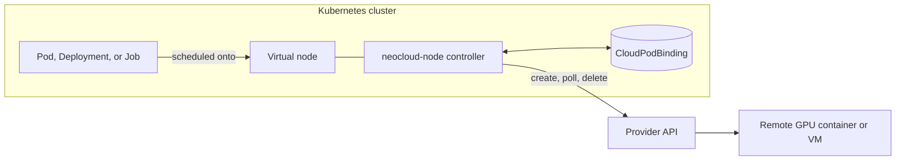

# AIBrix NeoCloud Node

[](https://github.com/aibrix/neocloud-node/actions/workflows/ci.yml)
[](LICENSE)

Run Kubernetes GPU Pods on RunPod, Vast.ai, and Lambda Cloud.

NeoCloud Node adds a [Virtual Kubelet](https://virtual-kubelet.io) node to your
cluster. A Pod scheduled onto that node runs as a GPU instance at a cloud
provider, and you keep managing it with `kubectl`, Deployments, and Jobs.

> [!WARNING]
> NeoCloud Node is experimental. Every Pod on the virtual node is a paid cloud
> instance.



The controller records each remote instance in a `CloudPodBinding` keyed by
the Pod UID, so a controller restart or a retried API call never creates a
second paid instance.

## Installation

You need a Kubernetes cluster, Helm 3, and permission to create CRDs and
cluster-scoped RBAC. For a real provider, you also need its API key.

### 1. Install with the fake provider

The chart is installed from a checkout of this repository. The default `fake`
provider simulates the remote lifecycle, so this step needs no credentials and
costs nothing.

```bash
git clone https://github.com/aibrix/neocloud-node.git
cd neocloud-node
helm upgrade --install neocloud ./charts/neocloud-node \
  --namespace aibrix-system --create-namespace --wait --timeout 3m
kubectl get node neocloud-node
```

> [!NOTE]
> The chart defaults to the `0.1.0` release image. Public endpoints, readiness
> probes, `restartPolicy: Always`, and env from Secrets and ConfigMaps were
> added after that release. To use them, run an image built from `main` by
> adding `--set image.tag=<full-commit-sha>` to every `helm upgrade`. See
> [container images](docs/development.md#container-images).

### 2. Run a test Pod

A Pod runs on the virtual node when it selects the node, tolerates its
`cloud.aibrix.ai/provider` taint, and requests `nvidia.com/gpu`, as in
[`config/samples/fake-pod.yaml`](config/samples/fake-pod.yaml).

```bash
kubectl apply -f config/samples/fake-pod.yaml
kubectl get pod neocloud-node-fake-smoke
kubectl get cloudpodbindings
kubectl delete -f config/samples/fake-pod.yaml
```

On DigitalOcean Kubernetes, Pods may also need a temporary toleration; see the
[chart guide](charts/neocloud-node/README.md#smoke-validation-and-doks).

### 3. Connect a cloud provider

Store the API key in a Secret, then point the release at it. API keys never go
into Helm values. Delete all workloads on the node before you switch providers.

```bash
kubectl -n aibrix-system create secret generic neocloud-runpod \
  --from-literal=apiKey="$RUNPOD_API_KEY"
helm upgrade --install neocloud ./charts/neocloud-node -n aibrix-system --wait \
  --set provider=runpod --set credentials.runpod.secretName=neocloud-runpod
```

| Provider | `provider` | Secret reference | Also required |
| --- | --- | --- | --- |
| RunPod | `runpod` | `credentials.runpod.secretName` | Nothing |
| Vast.ai | `vast` | `credentials.vast.secretName` | Nothing |
| Lambda Cloud | `lambda` | `credentials.lambda.secretName` | A runner callback URL reachable from the VM, and a region, instance type, and SSH key names. See the [Lambda adapter guide](docs/lambda-adapter.md). |

Pods now tolerate `cloud.aibrix.ai/provider=<provider>` instead of `fake`, and
each one starts a billed instance. Delete Pods when you are done and confirm in
the provider console that the instance is gone.

### 4. Serve a model

[Run Qwen with vLLM or SGLang](examples/inference/README.md) on one RunPod A40,
including the public endpoint, a test request, and cleanup.

### Upgrade and uninstall

Helm does not upgrade CRDs, and remote instances must be deleted while the
controller is still running. Follow the
[chart guide](charts/neocloud-node/README.md#upgrades-and-removal).

## Provider Compatibility

✅ Supported ⚠️ Partial ❌ Not supported

| Capability | RunPod | Vast.ai | Lambda Cloud |
| --- | :---: | :---: | :---: |
| Maturity | Most tested | Experimental | Experimental |
| Runs as | Container | Container | VM with a cloud-init runner |
| **Lifecycle** | | | |
| Create and delete from Kubernetes | ✅ | ✅ | ✅ |
| Pod status | ✅ | ✅ | ✅ |
| Exit code (`Succeeded` or `Failed`) | ❌ ¹ | ❌ ¹ | ✅ |
| Deployments and Jobs | ✅ | ✅ | ✅ |
| No duplicate instance after a restart | ✅ | ✅ | ✅ |
| Orphan sweeper | ✅ | ✅ | ✅ |
| **Debugging** | | | |
| `kubectl logs` | ❌ | ❌ | ❌ |
| `kubectl exec` and `attach` | ❌ | ❌ | ❌ |
| `kubectl port-forward` | ❌ | ❌ | ❌ |
| **Networking** | | | |
| Public endpoints for container ports | ✅ | ❌ | ❌ |
| Readiness probe (`httpGet`, `tcpSocket`) | ✅ | ❌ ² | ❌ ² |
| Kubernetes Service ³ | ❌ | ❌ | ❌ |
| **Images and storage** | | | |
| Private image registry | ⚠️ ⁴ | ❌ | ❌ |
| Persistent storage | ⚠️ ⁵ | ❌ | ⚠️ ⁵ |
| **Cost and placement** | | | |
| Spot or interruptible instances | ✅ | ✅ | ❌ |
| Price ceiling (`cloud.aibrix.ai/max-price`) | ⚠️ ⁶ | ✅ | ⚠️ ⁶ |
| Fallback to another provider | ✅ | ✅ | ✅ |

1. The provider does not report the container exit code, so every exit is
   reported as `Failed`. A Job retries even a run that exited with code 0.
2. The controller runs the probe against the public endpoint, which this
   provider does not publish yet. A Pod with a readiness probe never becomes
   `Ready`.
3. Providers publish a container port on a different public port. Clients read
   the `cloud.aibrix.ai/endpoints` Pod annotation instead.
4. Reference an existing RunPod registry auth with the
   `cloud.aibrix.ai/runpod-registry-auth-id` annotation. Kubernetes
   `imagePullSecrets` are not converted.
5. Attach an existing RunPod network volume or Lambda file system with the
   `cloud.aibrix.ai/runpod-network-volume-id` or
   `cloud.aibrix.ai/lambda-file-system-ids` annotation. Kubernetes volumes are
   rejected.
6. Enforced only when placement offers are configured.

On every provider, a Pod must have exactly one container with a GPU request,
and no init containers, volumes, host network, or privileged mode. The
[Pod compatibility matrix](docs/compatibility-matrix.md) lists every supported
field.

## Documentation

| Topic | Document |
| --- | --- |
| Helm values, upgrades, migration | [Chart guide](charts/neocloud-node/README.md) |
| Supported Pod fields and their semantics | [Pod compatibility matrix](docs/compatibility-matrix.md) |
| Serving vLLM and SGLang | [Inference examples](examples/inference/README.md) |
| Provider adapters | [RunPod](docs/runpod-adapter.md), [Lambda Cloud](docs/lambda-adapter.md), [VM runner](docs/vm-runner.md) |
| Local checks, images, paid smoke tests | [Development guide](docs/development.md) |

## Development

Requires Go 1.26.11 or newer and Kustomize 5.4 or newer.

```bash
make verify
make test-race
```

See the [development guide](docs/development.md) for container images and the
gated smoke tests that create real cloud resources.

## Contributing

See [CONTRIBUTING.md](CONTRIBUTING.md). Report security issues as described in
[SECURITY.md](SECURITY.md).

## License

[Apache 2.0](LICENSE)
