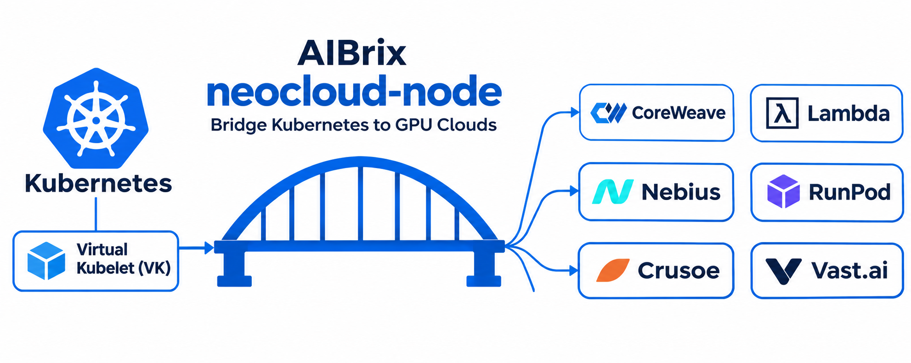

# AIBrix NeoCloud Node

[](https://github.com/aibrix/neocloud-node/actions/workflows/ci.yml)
[](LICENSE)

Run Kubernetes GPU Pods on RunPod, Vast.ai, and Lambda Cloud.

NeoCloud Node adds a [Virtual Kubelet](https://virtual-kubelet.io) node to your
cluster. A Pod scheduled onto that node runs as a GPU instance at a cloud
provider, and you keep managing it with `kubectl`, Deployments, and Jobs.

> [!WARNING]
> NeoCloud Node is experimental. Every Pod on the virtual node is a paid cloud
> instance.



*Cloud providers in the illustration show the concept; see
[Provider Compatibility](#provider-compatibility) for implemented adapters.*

The controller records each remote instance in a `CloudPodBinding` keyed by
the Pod UID, so a controller restart or a retried API call never creates a
second paid instance.

## Getting Started

Requires a Kubernetes cluster, `kubectl`, Helm 3, and a RunPod API key with
available GPU capacity and account balance.

```bash
git clone https://github.com/aibrix/neocloud-node.git
cd neocloud-node

export RUNPOD_API_KEY="<your-api-key>"
kubectl create namespace aibrix-system --dry-run=client -o yaml | kubectl apply -f -
kubectl -n aibrix-system create secret generic neocloud-runpod \
  --from-literal=apiKey="$RUNPOD_API_KEY"

helm install neocloud ./charts/neocloud-node \
  --namespace aibrix-system --wait --timeout 3m \
  --set-string image.tag=1b59e5db2e21cfa9bcf7357dbf3ab4f4900b0e8a \
  --set provider=runpod \
  --set credentials.runpod.secretName=neocloud-runpod \
  --set-string env.GPU_BURST_ADVERTISE_GPU_COUNT=1
kubectl get node neocloud-node
```

For provider configuration, upgrades, and removal, see the
[chart guide](charts/neocloud-node/README.md).

## Usage

### Run a GPU Pod

Run Qwen2.5-1.5B-Instruct with vLLM on one RunPod A40 in the `default`
namespace. Applying the sample creates a paid GPU instance:

```bash
kubectl apply -f examples/inference/qwen-vllm.yaml
kubectl get pod qwen-vllm -w
```

Once the Pod is `Ready` (`1/1`), stop the watch with Ctrl-C. The readiness
probe checks the model server; image pull and model loading can take several
minutes. View its binding with:

```bash
kubectl get cloudpodbindings
```

See the [inference guide](examples/inference/README.md) to find the public
endpoint and send a request. The example exposes an unauthenticated API for a
short trial. Remove its DOKS-specific toleration on other clusters.

### Clean up

```bash
kubectl delete -f examples/inference/qwen-vllm.yaml --wait=true --timeout=120s
kubectl get cloudpodbindings \
  -l cloud.aibrix.ai/pod-name=qwen-vllm
```

Confirm the binding and RunPod instance are deleted before stopping the
controller. Keep the Helm release for subsequent workloads.

## Provider Compatibility

✅ Supported ⚠️ Partial ❌ Not supported

| Capability | RunPod | Vast.ai | Lambda Cloud |
| --- | :---: | :---: | :---: |
| Maturity | Most tested | Experimental | Experimental |
| Runs as | Container | Container | VM with a cloud-init runner |
| **Lifecycle** | | | |
| Create and delete from Kubernetes | ✅ | ✅ | ✅ |
| Pod status | ✅ | ✅ | ✅ |
| Exit code (`Succeeded` or `Failed`) | ❌ ¹ | ❌ ¹ | ✅ |
| Deployments and Jobs | ✅ | ✅ | ✅ |
| No duplicate instance after a restart | ✅ | ✅ | ✅ |
| Orphan sweeper | ✅ | ✅ | ✅ |
| **Debugging** | | | |
| `kubectl logs` | ❌ | ❌ | ❌ |
| `kubectl exec` and `attach` | ❌ | ❌ | ❌ |
| `kubectl port-forward` | ❌ | ❌ | ❌ |
| **Networking** | | | |
| Public endpoints for container ports | ✅ | ❌ | ❌ |
| Readiness probe (`httpGet`, `tcpSocket`) | ✅ | ❌ ² | ❌ ² |
| Kubernetes Service ³ | ❌ | ❌ | ❌ |
| **Images and storage** | | | |
| Private image registry | ⚠️ ⁴ | ❌ | ❌ |
| Persistent storage | ⚠️ ⁵ | ❌ | ⚠️ ⁵ |
| **Cost and placement** | | | |
| Spot or interruptible instances | ✅ | ✅ | ❌ |
| Price ceiling (`cloud.aibrix.ai/max-price`) | ⚠️ ⁶ | ✅ | ⚠️ ⁶ |
| Fallback to another provider | ✅ | ✅ | ✅ |

1. The provider does not report the container exit code, so every exit is
   reported as `Failed`. A Job retries even a run that exited with code 0.
2. The controller runs the probe against the public endpoint, which this
   provider does not publish yet. A Pod with a readiness probe never becomes
   `Ready`.
3. Providers publish a container port on a different public port. Clients read
   the `cloud.aibrix.ai/endpoints` Pod annotation instead.
4. Reference an existing RunPod registry auth with the
   `cloud.aibrix.ai/runpod-registry-auth-id` annotation. Kubernetes
   `imagePullSecrets` are not converted.
5. Attach an existing RunPod network volume or Lambda file system with the
   `cloud.aibrix.ai/runpod-network-volume-id` or
   `cloud.aibrix.ai/lambda-file-system-ids` annotation. Kubernetes volumes are
   rejected.
6. Enforced only when placement offers are configured.

On every provider, a Pod must have exactly one container with a GPU request,
and no init containers, volumes, host network, or privileged mode. The
[Pod compatibility matrix](docs/compatibility-matrix.md) lists every supported
field.

## Documentation

| Topic | Document |
| --- | --- |
| Helm values, upgrades, migration | [Chart guide](charts/neocloud-node/README.md) |
| Provider configuration and credentials | [Provider guide](docs/providers.md) |
| Supported Pod fields and their semantics | [Pod compatibility matrix](docs/compatibility-matrix.md) |
| Serving vLLM and SGLang | [Inference examples](examples/inference/README.md) |
| Provider adapters | [RunPod](docs/runpod-adapter.md), [Lambda Cloud](docs/lambda-adapter.md), [VM runner](docs/vm-runner.md) |

## Contributing

See [CONTRIBUTING.md](CONTRIBUTING.md). Report security issues as described in
[SECURITY.md](SECURITY.md).

## License

[Apache 2.0](LICENSE)
