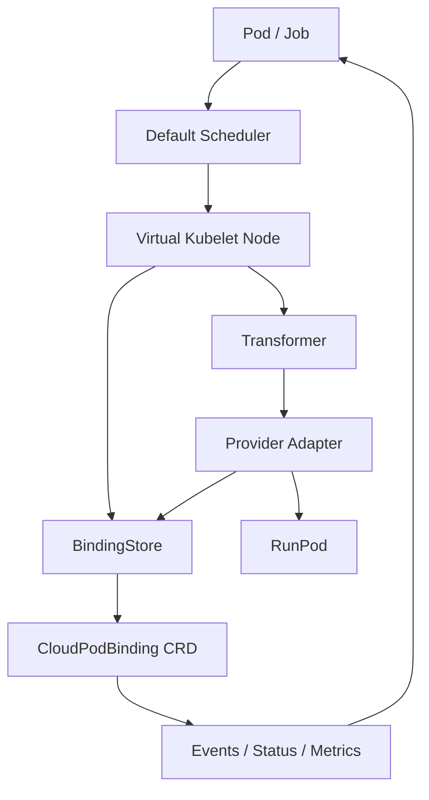

# Kubernetes-native Cloud Virtual Kubelet: rewrite analysis

Date: 2026-06-05

Code baselines:

- `BSVogler/k8s-runpod-kubelet`: commit `d9b7e1667618f80161b8378a0a021a823f0a8d8e`, 2025-09-06, `heartbeat`.
- `skypilot-org/skypilot`: commit `ee5ec63126a64b651834c1f6e439b3c7f9e954de`, 2026-06-05, `[Core] Deep-merge workspace config with global cloud config (#9788)`.

Detailed phased execution plan: [Cloud Virtual Kubelet 工作计划](work-plan.md).

Naming note: the selected project name is **AIBrix GPU Burst Node**. Historical `cvk` references are early working-name placeholders and should be replaced by `gpu-burst-node` as implementation files are created.

## Executive conclusion

`BSVogler/k8s-runpod-kubelet` 已经证明了最小闭环成立: 一个 Virtual Kubelet 节点可以接收 Pod, 调 RunPod API 创建远端 pod, 再把远端状态翻译回 Kubernetes Pod status。它和我们的初始直觉高度重合。

但它不适合作为多云商业化产品的底座。主要原因不是代码风格, 而是控制面模型: 状态以内存 map 和 Pod annotation 为主, 没有 durable binding/finalizer/idempotency, PodSpec 支持面很窄, provider 耦合强, 还绑定了外部 Conduit 注册和 heartbeat。它是很有价值的 reference implementation, 不是 production substrate。

SkyPilot 的价值在另一个层面: 它不是简单的 provider SDK 封装, 而是把资源规格、价格 catalog、云能力矩阵、优化器、failover、managed jobs、service placement、policy、workspace、request queue、cost metrics 组合成一个 cloud business control plane。我们的机会是把这些能力 Kubernetes-native 化: 不再提供一套 SkyPilot YAML/CLI, 而是用 Pod、Job、Virtual Kubelet、一个内部状态 CRD、controller metrics 和后续可选策略能力来表达。MVP 不依赖 Kueue、自定义 scheduler 或一组复杂 CRD。

项目定位应改成:

> Kubernetes-native GPU cloud burst control plane: standard Kubernetes workloads in, provider-native GPU instances out, with durable lifecycle, multi-provider cost/capacity routing, policy, recovery, and accounting.

## BSVogler/k8s-runpod-kubelet: code review

### What it already does well

1. It proves Virtual Kubelet can be the Kubernetes entrypoint.
   `cmd/virtual_kubelet/main.go` uses upstream Virtual Kubelet node/pod controllers, so normal Pod scheduling can target a virtual node.

2. It uses direct RunPod API lifecycle.
   `pkg/virtual_kubelet/runpod_client.go` implements GPU type listing, pod creation, status fetching and termination.

3. It exposes useful provider hints via annotations.
   GPU type, cloud type, datacenter, port behavior, job fallback annotation and owner Job lookup are useful ideas to keep.

4. It contains operational learnings worth preserving.
   Examples: RunPod status mapping, datacenter validation, handling stuck terminating pods, and mapping Job annotations down to Pods.

### Blocking technical issues

| Area | Evidence | Why it matters | Rewrite requirement |
| --- | --- | --- | --- |
| Mandatory third-party control plane | `NewProvider()` calls `registerWithConduit()` and fails provider init if `CONDUIT_API_TOKEN` is missing. See [`pkg/virtual_kubelet/kubelet.go`](https://github.com/BSVogler/k8s-runpod-kubelet/blob/d9b7e1667618f80161b8378a0a021a823f0a8d8e/pkg/virtual_kubelet/kubelet.go#L333-L379), [`registerWithConduit`](https://github.com/BSVogler/k8s-runpod-kubelet/blob/d9b7e1667618f80161b8378a0a021a823f0a8d8e/pkg/virtual_kubelet/kubelet.go#L64-L161). | This couples an infrastructure component to an external SaaS heartbeat path. It blocks self-hosted and enterprise deployments. | Core kubelet/controller must run without external SaaS. Optional telemetry must be disabled by default and separable. |
| State is not durable | Provider state is in `pods`, `podStatus`, `deletedPods` maps. See [`Provider`](https://github.com/BSVogler/k8s-runpod-kubelet/blob/d9b7e1667618f80161b8378a0a021a823f0a8d8e/pkg/virtual_kubelet/kubelet.go#L26-L52). | Process restart loses create/delete intent. Remote resources can leak or be double-created. | Add `CloudPodBinding` CRD keyed by Pod UID with provider ID, phase, finalizer, observed generation and idempotency token. |
| Create errors are hidden | `CreatePod()` logs `DeployPodToRunPod` error but returns `nil`. See [`CreatePod`](https://github.com/BSVogler/k8s-runpod-kubelet/blob/d9b7e1667618f80161b8378a0a021a823f0a8d8e/pkg/virtual_kubelet/kubelet.go#L383-L418). | Kubernetes believes Pod creation succeeded while remote create failed. Users see vague Pending/Failed behavior. | Return errors or set explicit condition/event. Admission should reject impossible specs before scheduling. |
| Delete is not idempotent enough | `DeletePod()` relies on annotation, records in-memory deletion, removes maps even if remote terminate fails. See [`DeletePod`](https://github.com/BSVogler/k8s-runpod-kubelet/blob/d9b7e1667618f80161b8378a0a021a823f0a8d8e/pkg/virtual_kubelet/kubelet.go#L620-L651). | Deletion after restart or API failure can leak paid resources. | Finalizer-driven deletion. Remote `NotFound` must be success; retryable errors must keep finalizer. |
| PodSpec support is too narrow | `PrepareRunPodParameters()` uses the first container image and ignores most command/args, multi-container, restartPolicy, imagePullSecrets, securityContext, resource shape and volumes. See [`PrepareRunPodParameters`](https://github.com/BSVogler/k8s-runpod-kubelet/blob/d9b7e1667618f80161b8378a0a021a823f0a8d8e/pkg/virtual_kubelet/runpod_client.go#L1248-L1377). | "Standard Pod to instance" cannot mean silent partial semantics. Unsupported fields must be explicit. | Define a Pod compatibility contract. Validate by webhook. Start with one main container plus init/env/secret/imagePullSecret/ports/resources; reject others. |
| Secret handling is unsafe | It reads Secret refs and volume Secret items into env vars. See env extraction around [`runpod_client.go`](https://github.com/BSVogler/k8s-runpod-kubelet/blob/d9b7e1667618f80161b8378a0a021a823f0a8d8e/pkg/virtual_kubelet/runpod_client.go#L866-L1054). | Broad secret reads plus semantic conversion of secret volumes to envs can leak data and surprise users. | Namespace-scoped credential model. Do not rewrite volume semantics into env. Use explicit secret export allowlist. |
| RBAC is too broad | Deploy/Helm ClusterRole grants broad pods, nodes, namespaces, configmaps, secrets. See [`deploy/kubelet.yaml`](https://github.com/BSVogler/k8s-runpod-kubelet/blob/d9b7e1667618f80161b8378a0a021a823f0a8d8e/deploy/kubelet.yaml). | A cloud provider adapter should not read all cluster secrets. | Least privilege: watch assigned Pods, own CRDs, Events, Leases; read only referenced Secrets through namespace-scoped service account or controller-mediated projection. |
| Node capacity/status are hardcoded | `GetNodeStatus()` returns `cpu=20`, `memory=100Gi`, `pods=100`, `nvidia.com/gpu=4`. See [`GetNodeStatus`](https://github.com/BSVogler/k8s-runpod-kubelet/blob/d9b7e1667618f80161b8378a0a021a823f0a8d8e/pkg/virtual_kubelet/kubelet.go#L1098-L1186). | Scheduler decisions become fake. Quota and admission cannot reason about real provider inventory. | MVP should expose conservative virtual capacity for default scheduler placement, then do provider-specific placement/validation inside CVK. Kueue/ResourceFlavor can be added later for quota. |
| Status is synthetic and incomplete | Status translation hardcodes one container, fake IPs and start times. See [`translateRunPodStatus`](https://github.com/BSVogler/k8s-runpod-kubelet/blob/d9b7e1667618f80161b8378a0a021a823f0a8d8e/pkg/virtual_kubelet/kubelet.go#L1847-L2024). | Users and controllers cannot trust status for real debugging or automation. | Status must be derived from provider state, exit code, timestamps, endpoints and logs when available. Unknown fields should remain unknown. |
| Logs/exec unsupported | `RunInContainer()` and `GetContainerLogs()` return unsupported. See [`RunInContainer`](https://github.com/BSVogler/k8s-runpod-kubelet/blob/d9b7e1667618f80161b8378a0a021a823f0a8d8e/pkg/virtual_kubelet/kubelet.go#L2026-L2066). | Kubernetes users expect `kubectl logs` at minimum for batch workloads. | MVP should support logs for RunPod if API allows; otherwise expose clear Events and link annotations. Exec can remain explicitly unsupported. |
| Force-deleting user Pods | Cleanup paths can force delete Kubernetes Pods after timeouts. See [`cleanupStuckTerminatingPods`](https://github.com/BSVogler/k8s-runpod-kubelet/blob/d9b7e1667618f80161b8378a0a021a823f0a8d8e/pkg/virtual_kubelet/kubelet.go#L1229-L1377) and [`ForceDeletePod`](https://github.com/BSVogler/k8s-runpod-kubelet/blob/d9b7e1667618f80161b8378a0a021a823f0a8d8e/pkg/virtual_kubelet/kubelet.go#L1775-L1796). | This can hide provider leaks or delete evidence before controller reconciliation is complete. | Controllers should own finalizers and conditions, not force-remove user workloads except by explicit admin policy. |
| Idempotency is weak | Create retries do not use a Pod UID idempotency key. REST retry can duplicate on ambiguous provider errors. | GPU clouds often have slow/partial create APIs. Duplicate creates are expensive. | `Create(ctx, request)` must be idempotent by external name/idempotency key. Reconcile must list-by-label/name before creating. |
| Tests are not reliable | Current HEAD fails `go test ./...`: `runpod_test.go:17:2` unused import and `runpod_test.go:60:24` `config.Config is not a type`. | The baseline is not continuously verifiable. | Build fake provider and controller tests first; gate real provider integration tests behind env vars. |

### Decision on reuse

Keep as reference:

- Annotation vocabulary for provider hints. In MVP, annotations remain the user-facing configuration surface; CRD stores observed state, not desired policy.
- RunPod REST/GraphQL learnings, datacenter/GPU filtering, port handling.
- Job annotation fallback pattern.
- Operational cases around missing remote pod, stuck termination and completion detection.

Do not reuse as core:

- Mandatory Conduit registration.
- In-memory lifecycle state.
- Full Pod metadata updates as state store.
- Broad RBAC.
- Synthetic status and hardcoded capacity.
- Silent create/delete errors.
- Single-provider package boundaries.

## SkyPilot: what to learn

SkyPilot is the better benchmark for product capability, but not for Kubernetes integration shape.

### 1. Provider abstraction and capability matrix

SkyPilot's base cloud abstraction explicitly models provider features such as stop, multi-node, Docker image, spot, ports, storage mounting, controller hosting, auto-terminate/autostop/autodown, high-performance network and local disk. See [`CloudImplementationFeatures`](https://github.com/skypilot-org/skypilot/blob/ee5ec63126a64b651834c1f6e439b3c7f9e954de/sky/clouds/cloud.py#L33-L64).

RunPod then declares unsupported features like stop, multi-node, storage mounting, HA controllers and custom networking. See [`sky/clouds/runpod.py`](https://github.com/skypilot-org/skypilot/blob/ee5ec63126a64b651834c1f6e439b3c7f9e954de/sky/clouds/runpod.py#L21-L73). Lambda declares no spot support, no image ID, no stop, no custom network and no HA controllers. See [`sky/clouds/lambda_cloud.py`](https://github.com/skypilot-org/skypilot/blob/ee5ec63126a64b651834c1f6e439b3c7f9e954de/sky/clouds/lambda_cloud.py#L28-L69).

Kubernetes rewrite implication:

- Build a `ProviderCapability` matrix as first-class data.
- Admission should reject unsupported Pod features early.
- Scheduler/controller should use provider capabilities before trying API calls.
- Capabilities must be versioned because provider APIs change.

### 2. Resource model, catalog and optimizer

SkyPilot's `Resources` object includes cloud, instance type, CPU, memory, accelerators, region, zone, spot, disk, ports, labels, autostop, max hourly cost and priority. See [`Resources.__init__`](https://github.com/skypilot-org/skypilot/blob/ee5ec63126a64b651834c1f6e439b3c7f9e954de/sky/resources.py#L142-L230).

Its optimizer fills partial resource requests into concrete launchable resources, filters blocked resources, estimates cost/time and sets `best_resources`. See [`Optimizer.optimize`](https://github.com/skypilot-org/skypilot/blob/ee5ec63126a64b651834c1f6e439b3c7f9e954de/sky/optimizer.py#L71-L142) and [`_fill_in_launchable_resources`](https://github.com/skypilot-org/skypilot/blob/ee5ec63126a64b651834c1f6e439b3c7f9e954de/sky/optimizer.py#L1671-L1791).

The catalog layer is a major asset. RunPod catalog refreshes every 7 hours and stores instance type, accelerator, count, vCPU, memory, region, price, spot price and availability zone. See [`runpod_catalog.py`](https://github.com/skypilot-org/skypilot/blob/ee5ec63126a64b651834c1f6e439b3c7f9e954de/sky/catalog/runpod_catalog.py#L15-L111). Lambda catalog does similar but encodes Lambda-specific constraints such as no zones and no spot. See [`lambda_catalog.py`](https://github.com/skypilot-org/skypilot/blob/ee5ec63126a64b651834c1f6e439b3c7f9e954de/sky/catalog/lambda_catalog.py#L16-L148).

Kubernetes rewrite implication:

- We need a catalog service/controller, not hardcoded provider queries in create path.
- Catalog rows should start as an internal cache/library used by `Transformer` or a simple placement function. Expose them as metrics or read-only API later.
- Placement should be a CVK provider decision recorded into `CloudPodBinding`, not hidden inside a CLI optimizer.
- Kueue `ResourceFlavor` generation is a later optional integration after the simple default-scheduler path is stable.

### 3. RunPod/Lambda provider implementation details

SkyPilot's RunPod implementation still uses VM/Ray cluster semantics: head/worker names, SSH setup, RunPod pod templates, public key injection and `sleep infinity`. See [`sky/provision/runpod/instance.py`](https://github.com/skypilot-org/skypilot/blob/ee5ec63126a64b651834c1f6e439b3c7f9e954de/sky/provision/runpod/instance.py#L48-L149) and [`runpod/utils.py`](https://github.com/skypilot-org/skypilot/blob/ee5ec63126a64b651834c1f6e439b3c7f9e954de/sky/provision/runpod/utils.py#L286-L407).

Still, there are useful details:

- RunPod GPU name normalization (`GPU_NAME_MAP`) and spot pod creation. See [`runpod/utils.py`](https://github.com/skypilot-org/skypilot/blob/ee5ec63126a64b651834c1f6e439b3c7f9e954de/sky/provision/runpod/utils.py#L16-L79).
- Private registry auth through RunPod templates. See [`_create_template_for_docker_login`](https://github.com/skypilot-org/skypilot/blob/ee5ec63126a64b651834c1f6e439b3c7f9e954de/sky/provision/runpod/utils.py#L247-L283).
- RunPod network volume support. See [`run_instances`](https://github.com/skypilot-org/skypilot/blob/ee5ec63126a64b651834c1f6e439b3c7f9e954de/sky/provision/runpod/instance.py#L83-L118).
- Lambda capacity precheck before launch to avoid expensive/rate-limited launch probes. See [`LambdaCloudClient.create_instances`](https://github.com/skypilot-org/skypilot/blob/ee5ec63126a64b651834c1f6e439b3c7f9e954de/sky/provision/lambda_cloud/lambda_utils.py#L142-L185).
- Lambda firewall rule handling and region-specific capability exceptions. See [`open_ports`](https://github.com/skypilot-org/skypilot/blob/ee5ec63126a64b651834c1f6e439b3c7f9e954de/sky/provision/lambda_cloud/instance.py#L259-L340).

Kubernetes rewrite implication:

- Use SkyPilot's provider-specific learnings, not its SSH/Ray lifecycle.
- RunPod adapter should create a real containerized remote pod for the Kubernetes Pod's workload, not a head/worker control node.
- Lambda adapter likely needs a lightweight node agent or image bootstrap strategy, because Lambda Cloud exposes VM instances rather than direct Pod semantics.

### 4. Recovery and failover as core mechanism

SkyPilot managed jobs support launch retry, backoff, cleanup, persisted infra info, max restarts, exit-code based recovery, failover and eager failover. See [`StrategyExecutor`](https://github.com/skypilot-org/skypilot/blob/ee5ec63126a64b651834c1f6e439b3c7f9e954de/sky/jobs/recovery_strategy.py#L75-L260), [`_launch`](https://github.com/skypilot-org/skypilot/blob/ee5ec63126a64b651834c1f6e439b3c7f9e954de/sky/jobs/recovery_strategy.py#L456-L807), [`FailoverStrategyExecutor`](https://github.com/skypilot-org/skypilot/blob/ee5ec63126a64b651834c1f6e439b3c7f9e954de/sky/jobs/recovery_strategy.py#L840-L959) and [`EagerFailoverStrategyExecutor`](https://github.com/skypilot-org/skypilot/blob/ee5ec63126a64b651834c1f6e439b3c7f9e954de/sky/jobs/recovery_strategy.py#L961-L1040).

Kubernetes rewrite implication:

- For `Job`/`Pod`, expose recovery first through annotations and `CloudPodBinding.status.attempts`:
  - `retryOnProviderFailure`
  - `blockedOffers`
  - `sameRegionRetryWindow`
  - `eagerFallback`
  - `recoverOnExitCodes`
  - `checkpointRequired`
- Default scheduler remains the host-cluster scheduler. Provider rebinding happens inside the controller and is recorded in binding status.

### 5. Provider scoring

SkyPilot Serve has a SpotHedge dynamic fallback placer. It enumerates possible cloud/region/zone locations, tracks active/preempted status and chooses the cheapest active location that is not already used by current replicas. See [`spot_placer.py`](https://github.com/skypilot-org/skypilot/blob/ee5ec63126a64b651834c1f6e439b3c7f9e954de/sky/serve/spot_placer.py#L1-L280).

Kubernetes rewrite implication:

- Use the same idea as a provider scorecard for batch placement, not as a service policy layer.
- Track launch success rate, capacity errors, time to running, preemption, termination success and log availability.
- Feed scorecard data into placement once the first deterministic rule engine is stable.

## Core mechanisms to build

### 1. Cost/capacity-aware placement

Inputs:

- Pod resources: GPU model/count, CPU, memory, ephemeral disk, ports.
- Hints: max hourly cost, on-demand/spot preference, provider order, region order.
- Catalog: price, stock signal, launch latency, historical reliability.

Output:

- A selected `CloudCatalogOffer`.
- A `CloudPodBinding.status.placement` explaining why it was selected.
- Events listing rejected candidates and reasons.

This is the direct Kubernetes-native equivalent of SkyPilot optimizer plus catalog.

### 2. Multi-provider fallback

Mechanism examples:

- Try RunPod community H100 below `$X/hr`; fallback to RunPod secure cloud; then Lambda H100; then A100 if allowed.
- Avoid a provider/region for 30 minutes after capacity error.
- Prefer same provider for restart unless failure reason is capacity/preemption.

This turns scarce GPU capacity into a control-plane feature.

### 3. Spot/preemptible recovery

For training jobs:

- Detect provider preemption or lost remote instance.
- Run optional checkpoint hook before termination if provider gives notice.
- Restart in another offer if checkpoint exists.
- Annotate Job with recovery lineage.

### 4. Provider scorecard

Persist rolling observations:

- launch success rate
- capacity errors
- time to running
- preemption rate
- termination success
- log availability
- support for private registry, volumes, public IP, static port, SSH, metrics

Use it in placement scoring. This is a defensible moat because it improves with real workload volume.

### 5. Debuggability

Every remote lifecycle step should produce Kubernetes-native surfaces:

- Events on Pod and `CloudPodBinding`.
- Conditions with provider reason codes.
- Remote console/log URLs as annotations.
- `kubectl logs` when provider supports logs.
- `kubectl describe pod` should tell users why placement failed.

### 6. Provider plugin ecosystem

A new provider should implement:

- catalog fetcher
- capability matrix
- create/get/delete/logs adapter
- credential validator
- error classifier
- conformance tests

This is how to cover long-tail GPU clouds faster than SkyPilot if we keep the contract narrow and Kubernetes-native.

## Proposed architecture



### MVP CRD boundary

MVP should expose only one CRD:

`CloudPodBinding`

- One per remote workload, keyed by Pod UID.
- Namespaced with the source Pod.
- Spec: Pod ref, idempotency key, selected provider hints copied from annotations.
- Status: provider instance ID, phase, reason, message, endpoints, cost, attempts, last observed state, deletion state.
- Owns finalizer that prevents Pod cleanup from losing remote resource cleanup.

User-facing desired state remains standard `Pod` / `Job` plus annotations. `CloudPodBinding` is an internal durability and observability object, not the primary workload API.

### Internal interfaces

```go
type BindingStore interface {
    GetByPodUID(ctx context.Context, namespace string, uid types.UID) (*CloudPodBinding, error)
    CreateOrUpdate(ctx context.Context, binding *CloudPodBinding) error
    MarkDeleting(ctx context.Context, binding *CloudPodBinding) error
}

type Transformer interface {
    Transform(ctx context.Context, pod *corev1.Pod) (*WorkloadRequest, field.ErrorList)
}

type ProviderAdapter interface {
    Name() string
    Capabilities(ctx context.Context) (ProviderCapabilities, error)
    ClassifyError(error) ProviderError

    Create(ctx context.Context, req CreateRequest) (RemoteInstance, error)
    Get(ctx context.Context, id RemoteID) (RemoteInstance, error)
    Delete(ctx context.Context, id RemoteID) error

    Logs(ctx context.Context, id RemoteID, opts LogOptions) (io.ReadCloser, error)
}
```

Required semantics:

- `BindingStore`, `Transformer` and `ProviderAdapter` are code interfaces, not CRDs.
- MVP `BindingStore` implementation writes `CloudPodBinding`.
- `Transformer` is pure Pod-to-request logic and does not call cloud APIs.
- `ProviderAdapter` is cloud-only and does not call Kubernetes APIs.
- `Create` is idempotent by Pod UID/external name.
- `Delete` treats remote not-found as success.
- Provider errors are classified as capacity, auth, quota, invalid spec, rate limit, transient or unknown.

## MVP compatibility contract

Start narrow and honest:

Supported in MVP:

- one main container
- image, command, args, workingDir
- env, SecretKeyRef, ConfigMapKeyRef with explicit export
- resource requests/limits for CPU, memory, `nvidia.com/gpu`
- container ports
- restartPolicy `Never` and `OnFailure` for Jobs
- imagePullSecrets for providers that support private registry
- Pod labels/annotations propagated as provider tags where safe

Rejected in MVP:

- sidecars and multi-container Pods
- arbitrary volumes except explicitly supported Secret/ConfigMap export and provider network volume
- hostNetwork, hostPath, privileged securityContext
- serviceAccount token projection
- lifecycle hooks unless mapped explicitly
- exec
- daemonsets
- statefulsets without a storage story

This is still "standard Pod input" because unsupported semantics are rejected by validation with clear reasons, not silently ignored. MVP can do this in `Transformer` / `CreatePod`; a validating admission webhook can be added once the compatibility contract is stable.

## Roadmap

### Phase 0: design and scaffolding

- New `cvk` Go repo/binary that imports upstream `virtual-kubelet` as a library; do not fork upstream and do not reimplement kubelet control loops.
- Upstream Virtual Kubelet `PodLifecycleHandler` / `PodNotifier` / `NodeProvider` provider implementation.
- `CloudPodBinding` CRD only.
- Fake provider adapter.
- Transformer validation with compatibility contract.
- `CloudPodBinding` state machine.
- Unit tests for idempotency, deletion finalizer, status mapping and unsupported PodSpec rejection.

### Phase 1: RunPod production MVP

- RunPod adapter using durable binding.
- RunPod offer catalog with GPU/datacenter/price normalization.
- Idempotent create-by-Pod-UID.
- Finalizer-based cleanup and orphan sweeper.
- Pod Events and Conditions.
- Basic `kubectl logs` if API path is available; otherwise log URL/event integration.
- Helm chart with least-privilege RBAC.

Success criteria:

- controller restart does not double-create or leak
- remote manual deletion updates Pod condition correctly
- provider create 5xx/timeout does not duplicate remote pod
- `go test ./...` and fake-provider integration pass

### Phase 2: provider interface and Lambda Cloud runner

- Lambda adapter as VM-backed runner.
- Catalog refresh for Lambda and RunPod.
- Shared provider conformance tests for container-backed and VM-backed providers.

Success criteria:

- same `ProviderAdapter` contract supports RunPod container API and Lambda VM-backed runner
- Lambda VM cleanup is finalizer-driven and restart-safe

### Phase 3: placement/fallback mechanism

- Simple annotation/config-based fallback.
- Error classifier and blocked-offer cache.
- Provider capability and price cache.
- Candidate ranking explanation in Events and `CloudPodBinding.status`.
- Recovery lineage in `CloudPodBinding.status.attempts`.

Success criteria:

- same Job can fallback RunPod -> Lambda on capacity error
- invalid PodSpec does not fallback silently
- Events explain candidate ranking and rejection

### Phase 4: managed job recovery

- Recovery strategy for Kubernetes Jobs.
- Checkpoint hook contract.
- Recover-on-exit-code policy.
- Same-region retry window and eager fallback.
- Recovery lineage in `CloudPodBinding.status.attempts`.

Success criteria:

- preempted spot training job restarts in different provider/region
- user can audit every attempt through Kubernetes Events and CRD status

## Why rewrite, not fork

Forking `k8s-runpod-kubelet` would force us to unwind its core assumptions:

- remove Conduit dependency
- replace in-memory state with CRDs
- replace annotation-only binding with finalizers
- replace broad RBAC with scoped access
- replace synthetic status with durable status machine
- replace RunPod-only package layout with provider adapters
- replace silent failure behavior with Kubernetes-native events/conditions
- add admission validation and conformance testing

That is a structural rewrite. The existing project is still useful as a test oracle and provider behavior notebook, but the product should start from a clean CVK repo that consumes upstream Virtual Kubelet as a library.

Do not fork upstream `virtual-kubelet` for MVP. Upstream already exposes the right extension points: `PodLifecycleHandler`, `PodNotifier`, `NodeProvider`, and kubelet API route helpers. Our work belongs in a Kubernetes-aware provider wrapper plus internal `BindingStore` / `Transformer` / `ProviderAdapter` boundaries. Only propose upstream PRs if a concrete blocker appears, such as provider initialization hooks, retry policy, event filtering, or optional logs/metrics capability gaps.

## Immediate next work

1. Scaffold `cvk` as a new repo/binary that imports upstream `virtual-kubelet`.
2. Define only `CloudPodBinding` CRD for MVP.
3. Write fake provider adapter and `CloudPodBinding` state-machine tests before RunPod code.
4. Implement `BindingStore`, `Transformer`, and `ProviderAdapter` interfaces.
5. Implement RunPod adapter with idempotent create/delete and basic status sync.
6. Start placement/fallback mechanism only after the provider-neutral request and `ProviderAdapter` contract are stable.
