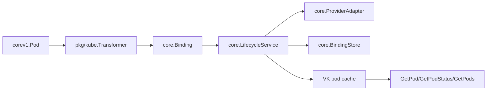

# Virtual Kubelet Provider Boundary

`pkg/vk.Provider` is the Kubernetes-facing provider boundary for AIBrix GPU Burst Node. It implements upstream `github.com/virtual-kubelet/virtual-kubelet/node/nodeutil.Provider`, so the pod lifecycle entrypoints use real `corev1.Pod` objects instead of a project-local pod struct.

## Implemented

- `CreatePod` and `UpdatePod` transform a `corev1.Pod` through `pkg/kube.Transformer`, then delegate idempotent remote creation to `core.LifecycleService`.
- `DeletePod` delegates remote cleanup to `core.LifecycleService`, removes the cached Kubernetes pod, and emits a terminal pod notification when the pod was known locally.
- `GetPod`, `GetPodStatus`, and `GetPods` sync remote provider status before returning and return `DeepCopy` objects so callers cannot mutate provider cache state.
- `NotifyPods` supports the Virtual Kubelet async pod status callback.
- `NewProviderFunc` returns an upstream `nodeutil.NewProviderFunc`, so the provider can be embedded directly in `nodeutil.NewNode` while letting upstream create the default node status provider.
- `GetStatsSummary` returns a stable kubelet stats summary containing known pod references and container names.
- Unsupported pod specs are returned as `errdefs.InvalidInput` before a provider adapter can launch remote resources.

## Explicitly Not Implemented Yet

These methods return `errdefs.InvalidInput` instead of silently succeeding:

- `GetContainerLogs`
- `RunInContainer`
- `AttachToContainer`
- `PortForward`

This is intentional. Most cloud GPU providers do not expose Kubernetes-compatible streaming semantics by default, and pretending these APIs work would make failure modes much harder to diagnose from Kubernetes clients.

## Current State Model

The provider keeps Kubernetes-visible pod objects in memory. Durable binding state still belongs to `core.BindingStore`, which can later move from the in-memory implementation to a host-cluster CRD-backed store without changing the provider interface.

